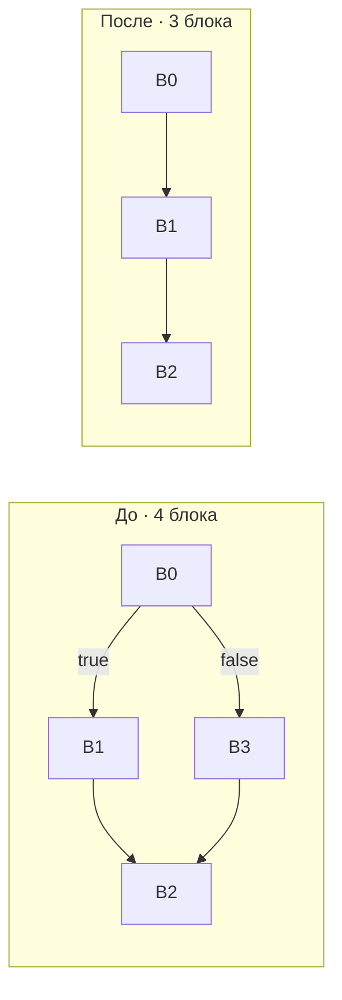

# HW4 — промежуточное представление и оптимизации Funny

Генератор трёхадресного кода, графа потока управления (CFG) и графа конфликтов временных. Нужен Python 3.10 или новее. Папки `hw2` и `hw3` должны лежать рядом с `hw4`.

## Запуск

Из папки `hw4` следующие команды показывают IR, графы и метрики до и после оптимизаций.

```bash
python3 funny_ir.py examples/branch.funny
python3 funny_ir.py examples/basic.funny
python3 funny_ir.py examples/loop.funny
```

Эта команда сохраняет JSON и два графа в папку `examples/results`.

```bash
python3 funny_ir.py examples/branch.funny --dot-dir examples/results --json --out examples/results/branch.ir.json
```

## Примеры

| Пример | Что смотреть | Текст | JSON | CFG | Конфликты |
| --- | --- | --- | --- | --- | --- |
| [basic.funny](examples/basic.funny) | Свёртка констант и удаление мёртвого кода | [IR](examples/basic.expected.txt) | [JSON](examples/results/basic.ir.json) | [DOT](examples/results/basic.cfg.dot) | [DOT](examples/results/basic.conflicts.dot) |
| [branch.funny](examples/branch.funny) | Константное условие, блоков 4 → 3 | [IR](examples/branch.expected.txt) | [JSON](examples/results/branch.ir.json) | [DOT](examples/results/branch.cfg.dot) | [DOT](examples/results/branch.conflicts.dot) |
| [loop.funny](examples/loop.funny) | Обратное ребро цикла и вызов функции | [IR](examples/loop.expected.txt) | [JSON](examples/results/loop.ir.json) | [DOT](examples/results/loop.cfg.dot) | [DOT](examples/results/loop.conflicts.dot) |

В `branch.funny` условие `limit > 3` всегда истинно. После оптимизации переход в `B3` исчезает вместе с блоком `else`.



Одно состояние CFG — один базовый блок. Именованные переменные обозначены `vN`, временные — `tN`. Число в квадратных скобках рядом с временной — её цвет. Строка «Сравнение» показывает изменение числа состояний, инструкций, временных и цветов.

Файлы DOT содержат обе версии каждого графа. Если установлен Graphviz, из папки `hw4` можно получить картинку такой командой.

```bash
dot -Tpng examples/results/branch.cfg.dot -o branch-cfg.png
```

## Флаги

| Флаг | Действие |
| --- | --- |
| `--no-const` | Отключить распространение и свёртку констант вместе с удалением недостижимых ветвей |
| `--no-simplify` | Отключить алгебраические упрощения |
| `--no-dce` | Отключить удаление мёртвых инструкций |
| `--no-opt` | Отключить все оптимизации |
| `--json` | Вывести IR, графы и метрики в JSON |
| `--out FILE` | Сохранить основной вывод в файл |
| `--dot-dir DIR` | Сохранить граф блоков и граф конфликтов в виде двух файлов DOT |

## Проверка

```bash
python3 test_ir.py
```

Тесты сравнивают выполнение IR до и после оптимизаций, проверяют графы и экспорт. Формат операций и API следующего этапа описаны в [IR_FORMAT.md](IR_FORMAT.md). Метрики и результаты приведены в [report.md](report.md).
